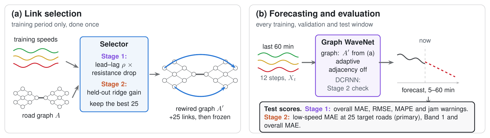
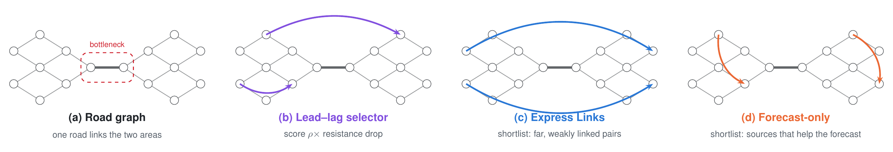
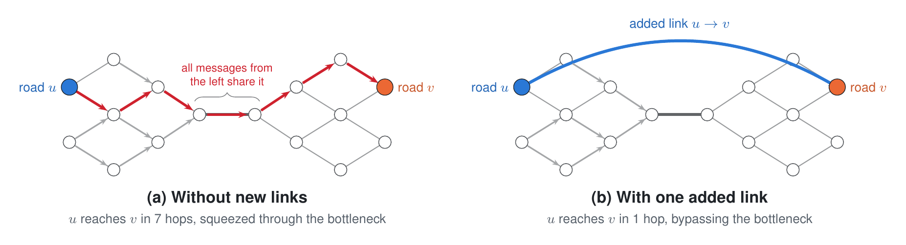
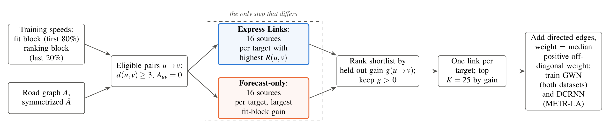

# Sparse Sensor Links for Low-Speed Traffic Forecasting

**MLR 570 Advanced Machine Learning, Fall 2026, American University of Sharjah**
Al Zahraa Altayasinah and Mohammed Alawadhi

This repository holds the code, saved results and report for our project. We asked a simple question: if a traffic-forecasting graph network is allowed only 25 extra links between road sensors, which links help it forecast slow traffic an hour ahead?

- **Final report:** [`report/Express_Links_Final_Report.pdf`](report/Express_Links_Final_Report.pdf); the LaTeX source is in [`report/latex/`](report/latex/).
- **Main result:** on METR-LA, the Forecast-only selector beat matched random links on all three seeds, with both Graph WaveNet and DCRNN, for 60-minute low-speed forecasts at the shared evaluation roads. The global virtual node had the lowest network-wide error. Neither diagnostic showed that the gain comes from relieving over-squashing.

## System architecture



The link selector adds 25 directed links to the road graph. The forecaster is then trained on the frozen, rewired graph. The kinds of links each rule tends to add:



The motivating idea: one added link lets a distant sensor's signal skip a bottleneck road. Our diagnostics did not establish that this mechanism explains the gains; see the report.



The two Stage 2 selectors step by step (Fig. 5 in the report). Both use the same eligible pairs, ridge screen and final ranking; they differ only in the shortlist step in the dashed box:



The first three figures use small illustrative graphs, not data. All TikZ sources are in [`docs/source/`](docs/source/).

The project ran in two stages:
- **Stage 1** (Google Colab) tested the method from our proposal: a greedy selector that scores each candidate link by lead–lag correlation × the drop in total effective resistance.
- **Stage 2** (single NVIDIA A10G GPU) followed up with two selectors built on a held-out ridge-regression screen: Express Links and Forecast-only. It added controls, two over-squashing diagnostics, a second model (DCRNN) and a tuning study.

Both stages use the METR-LA and PEMS-BAY benchmarks and Graph WaveNet with its learned adjacency switched off, trained for 100 epochs with seeds 0, 1 and 2. The two stages prepare missing data differently, so their numbers should not be compared directly:
- Stage 1 keeps missing readings as zeros and masks them.
- Stage 2 fills inputs causally and scores only observed readings.

## Repository layout

```
report/                          final report (PDF) and its LaTeX source
docs/                            framework, selector, motivation and Stage 2 selector figures (PNG, PDF, TikZ source)
report_figures/                  scripts + data that redraw every plot and appendix table in the report
stage1_leadlag_selector/         Stage 1: Colab notebooks, shared modules, results
stage2_predictive_selection/     Stage 2: GPU code, Slurm scripts, logs and results
  01_baseline_graph_wavenet/       baseline reproduction
  02_pilot/                        seed-0 pilot and the frozen METR-LA graphs
  03_main_code/                    six-way replication, diagnostics, DCRNN/DCGRU, tuning (keep in one folder)
  04_five_donor_diagnostic/        five-donor diagnostic
  05_analysis_snippets/            short analysis scripts used during the pilot
  logs/                            every Slurm log
  results/                         every result table, JSON and audit file
```

## Downloads and large files

The repository holds all code, logs and result tables. Large files are kept elsewhere:

| What | Where |
|---|---|
| METR-LA and PEMS-BAY speeds (`metr-la.h5`, `pems-bay.h5`) | DCRNN authors' Google Drive folder: <https://drive.google.com/drive/folders/10FOTa6HXPqX8Pf5WRoRwcFnW9BrNZEIX>. The scripts download it with `gdown`. If Drive limits downloads, they fall back to the mirror at <https://huggingface.co/datasets/TorchSpatiotemporal/ProcessedDatasets/tree/v1.0.0/traffic> |
| Road graphs (`adj_mx.pkl`, `adj_mx_bay.pkl`) and sensor locations | DCRNN repository, pinned commit: <https://github.com/liyaguang/DCRNN/tree/602afd9d767d3aa1c9b3eac51710d6aeee12c227/data/sensor_graph> |
| Graph WaveNet code | <https://github.com/nnzhan/Graph-WaveNet/tree/6b162e80c59a1d494809252eca055cff93dc66b1> (cloned by the scripts) |
| DCRNN PyTorch code | <https://github.com/chnsh/DCRNN_PyTorch/tree/d92490b808ba5c5be2f23d427d96e9a56b066d7f> (cloned by `setup_dcrnn.sh`) |
| Report, figures, and the raw GPU results archive | Submission folder on Google Drive: <https://drive.google.com/drive/folders/1ZGcI10I493nmwxAU-M8Ne3Z9Rl8hBO78> |
| Model checkpoints (`*.pt`) and saved test forecasts (`*.npz`) | Not uploaded because of their size. They are kept by the authors and are available on request |

The Stage 1 notebooks download the same speed files into the team's Drive folder (notebook 01). On the GPU server, the Stage 2 scripts cache everything in `/shared/$USER/express_links_cache`. The only `.npz` files in this repository are the small frozen METR-LA graphs in `02_pilot/reference_graphs_METR-LA/`.

## Where each report result comes from

| Report item | Code | Saved results |
|---|---|---|
| Figs. 1–3 and 5 (motivation, framework overview, selector illustration, the two Stage 2 selectors) | `docs/source/*.tex` (TikZ) | illustrations, no data |
| Table I (related methods), Table II (notation), Table III (protocol summary) | — | text tables |
| Stage 1: Algorithm 1, Fig. 4 (worked example), Fig. 6, Table IV, Fig. 7 | `stage1_leadlag_selector/notebooks/05_*`, `07_*`–`09_*` | `stage1_leadlag_selector/results/scores.csv`, `versions_summary_*.csv` |
| Stage 1 jam warnings: Table XII (Appendix B) | `stage1_leadlag_selector/code/metrics.py` | `report_figures/data/original_study.csv` |
| Baseline reproduction: Table V | `stage2_predictive_selection/01_baseline_graph_wavenet/` | job logs; `report_figures/data/baseline*.csv` |
| Seed-0 pilot | `02_pilot/express_links_step2_pilot.py` | `02_pilot/reference_graphs_METR-LA/` |
| Six-way comparison: Algorithm 2, Fig. 5, Table VI, Figs. 8–10; Appendix A (Table XI, Fig. 15) | `03_main_code/run_replication.py`, `collect_replication.py` | `results/pilot_output/full/comparison.csv`, `results/pilot_output/graphs/` |
| Week-swap and five-donor diagnostics: Table VII, Fig. 11 | `03_main_code/oversquash_test.py`, `04_five_donor_diagnostic/run_diagnostic.py` | `results/diagnostic_output/oversquash/`, `results/diagnostic/` |
| DCRNN and DCGRU: Table VIII, Fig. 12, Table XIII (Appendix B) | `03_main_code/run_dcrnn.py`, `run_other_model.py` | `results/other_model_output/` |
| Tuning: Tables IX–X, Figs. 13–14 | `03_main_code/tune_forecast_only.py` | `results/tuning_output/METR-LA/decisions/final_result.json` |

All figure and table numbers refer to `report/Express_Links_Final_Report.pdf`.

## Stage 1: the lead–lag selector

These are the Colab notebooks as we ran them, with their saved outputs. They mount our shared Drive folder and read and write there, so run them in order:

| Notebook | What it does |
|---|---|
| `01_data_preparation.ipynb` | Downloads METR-LA and PEMS-BAY; 70/10/20 split, 12 steps in and 12 out |
| `02_baseline_graph_wavenet.ipynb` | Reproduces Graph WaveNet with the learned adjacency off |
| `03_effective_resistance.ipynb` | Effective resistance between every pair of sensors |
| `04_bottleneck_report.ipynb` | Looks for bottleneck regions (METR-LA: 9 of 207 sensors behind 3 links; PEMS-BAY: none) |
| `05_leadlag_rho_and_express_links.ipynb` | Lead–lag strength ρ, then the greedy selector (Algorithm 1), with a hand-checked worked example |
| `06_evaluation_metrics.ipynb` | Writes `metrics.py`: MAE/RMSE/MAPE at 15/30/60 min and jam recall/precision |
| `07_seven_graph_versions.ipynb` | Builds the seven graphs |
| `08_train_METR-LA.ipynb`, `09_train_PEMS-BAY.ipynb` | Trains 7 graphs × 3 seeds on each dataset (42 runs) and scores them |
| `10_missing_data_check_METR-LA.ipynb` | Refills missing METR-LA inputs and retrains one seed as a data-handling check |

Notebooks 08 and 09 also trained a synthetic toy city and a simulated Sharjah network. Those rows appear in `scores_summary.csv`, but the report does not use them, because their traffic comes from rules we wrote ourselves.

## Stage 2: predictive link selection (GPU)

**Environment:**
- A single NVIDIA A10G GPU, with jobs submitted through Slurm.
- Python environment `/shared/$USER/envs/express-links`, built on `/opt/hpc-env/gpu311` plus `gdown` and `tables`.
- Data and model code are downloaded once into `/shared/$USER/express_links_cache`.
- Pinned code:
  - Graph WaveNet: `nnzhan/Graph-WaveNet`, commit `6b162e80c59a1d494809252eca055cff93dc66b1`.
  - DCRNN: `chnsh/DCRNN_PyTorch`, commit `d92490b808ba5c5be2f23d427d96e9a56b066d7f`, used unchanged.

**Keep `03_main_code/` in one folder.** The scripts import each other: `replication_core.py` loads `run_replication.py`, and the DCRNN, DCGRU, diagnostic and tuning scripts all build on `replication_core.py`. On the GPU server this folder was `/shared/$USER/express_links_replication_code`, and results went to `/shared/$USER/express_links_replication`.

| Step | How it was run |
|---|---|
| Baseline | `python -u express_links_step1.py --download-only`, then `bash submit_all.sh` |
| Pilot | `sbatch run_pilot.sbatch` |
| Six-way comparison | `sbatch prepare_replication.sbatch`, `sbatch reuse_metr_seed0.sbatch`, `bash submit_workers.sh <reuse job id>`, then `python collect_replication.py --project-dir /shared/$USER/express_links_replication` |
| Week-swap diagnostic and DCGRU | `bash submit_diagnostics.sh` |
| Five-donor diagnostic | `sbatch run_diagnostic.sbatch` |
| DCRNN | `bash setup_dcrnn.sh` (once), `bash submit_dcrnn.sh`, then `python run_dcrnn.py --collect` |
| Tuning | `bash submit_tuning.sh grid`, then `weights`, `inner`, `alloc`, `confirm` and `final`, each after the previous decide log says "Decision saved" |

### Rules written before the results

These files were written before the results they govern, and the report follows them:
- `03_main_code/PREREGISTERED_DIAGNOSTIC.txt`: week-swap diagnostic.
- `03_main_code/PREREGISTERED_ADDENDUM.txt`: implementation details and the second-model rule.
- `03_main_code/PREREGISTERED_ADDENDUM_2.txt` (21 Nov): the switch to the published DCRNN, with a dated note on the DCGRU runs.
- `03_main_code/PREREGISTERED_TUNING.txt`: tuning grid, thresholds and the locked final test.
- `04_five_donor_diagnostic/Express_Links_Diagnostic_Decision_Rule.md` (19 Nov): the five-donor gate.

We chose the six-way primary metric (low-speed error at the 25 target roads) after the seed-0 pilot. The report says this too.

## Redrawing the report figures

```
cd report_figures
pip install numpy pandas matplotlib
python make_paper_figs.py     # all plots -> figs/
python make_links_map.py      # the METR-LA link map -> figs/links_map.pdf
python make_supplement.py     # appendix tables -> supplement_*.tex
```

The scripts read the CSV and JSON files in `report_figures/data/`. These are copies of the saved results described above. Plots may differ by a pixel from the report's PDFs because of font and Matplotlib versions; the data are the same.

## Data and code we did not write

- **METR-LA and PEMS-BAY:** from Li et al., *Diffusion Convolutional Recurrent Neural Network* (ICLR 2018), downloaded by the scripts.
- **Graph WaveNet:** Wu et al., IJCAI 2019.
- **DCRNN PyTorch implementation:** `chnsh/DCRNN_PyTorch`.
- `report_figures/graph_sensor_locations.csv` is a copy of the sensor positions from `chnsh/DCRNN_PyTorch`.
